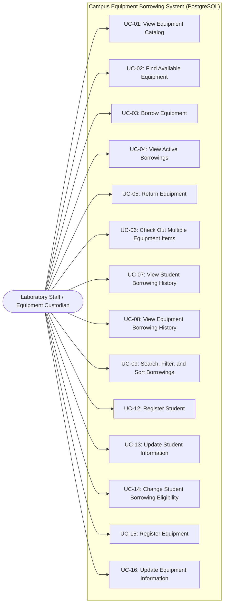

# Laboratory Activity 4 — Use Case Diagram, Catalog, Traceability & Evidence

> **Student Full Name:** Tee, Kim Hie F.  
> **Student ID:** 2024302101

---

## 1. Use Case Diagram (Laboratory Activity 4 Scope)

Primary Actor: **Laboratory Staff / Equipment Custodian**

---

## 2. Use Case Catalog (Appendix A)

| ID | Use Case | Lab 4 Classification |
|---|---|---|
| UC-01 | View Equipment Catalog | Required continuation |
| UC-02 | Find Available Equipment | Required continuation |
| UC-03 | Borrow Equipment | Required continuation |
| UC-04 | View Active Borrowings | Required continuation |
| UC-05 | Return Equipment | Required continuation |
| UC-06 | Check Out Multiple Equipment Items | Required new |
| UC-07 | View Student Borrowing History | Required new |
| UC-08 | View Equipment Borrowing History | Required new |
| UC-09 | Search, Filter, and Sort Borrowings | Required new |
| UC-10 | View Overdue Borrowings | Deferred to Laboratory Activity 5 |
| UC-11 | View Current Equipment Holder | Deferred to Laboratory Activity 5 |
| UC-12 | Register Student | Required new |
| UC-13 | Update Student Information | Required new |
| UC-14 | Change Student Borrowing Eligibility | Required new |
| UC-15 | Register Equipment | Required new |
| UC-16 | Update Equipment Information | Required new |
| UC-17–UC-27 | Maintenance, Condition, Renewal, Multi-Return, Summaries, Void | Deferred to Laboratory Activity 5 |
| UC-28–UC-33 | Reservations, Audit History, Staff Accounts, Exports, Notifications | Future scope |

---

## 3. Traceability & Acceptance Verification Matrix (Appendix C)

| Acceptance / Use Case | Primary Implementation Files | Rules Enforced | Verification Evidence |
|---|---|---|---|
| **A01 / UC-01** View Equipment Catalog | `EquipmentView.axaml`, `EquipmentViewModel.cs`, `BorrowingQueryService.GetEquipmentCatalogAsync`, `EfEquipmentRepository.GetAllAsync` | BR-05–07, BR-10, BR-18–19 | Displays `Identifier`, `Name`, `Description`, `IsAvailable`; distinguishes empty vs DB error + Retry. Verified in `PostgresIntegrationTests`. |
| **A02 / UC-02** Find Available Equipment | `EquipmentView.axaml` (`ShowOnlyAvailable`), `BorrowingQueryService.GetEquipmentCatalogAsync`, `EfEquipmentRepository.GetAvailableAsync` | BR-10, BR-18–19 | Filters out borrowed items; empty-match state distinct from connection error. Verified in `PostgresIntegrationTests`. |
| **A03 / UC-03** Borrow Equipment | `EquipmentViewModel.BorrowAsync`, `BorrowEquipmentService.BorrowAsync`, `Borrowing.cs` | BR-08–11, BR-14–16, BR-18–19 | Validates student eligibility, max 3 active limit, availability, and `ExpectedReturnDate > checkoutDate`; persists across fresh `DbContext`. |
| **A04 / UC-04** View Active Borrowings | `BorrowingsView.axaml`, `BorrowingsViewModel.cs`, `BorrowingQueryService.GetActiveBorrowingsAsync`, `EfBorrowingRepository.GetActiveBorrowingDetailsAsync` | BR-14, BR-18–19 | Joins active borrowings with student and equipment; excludes returned records; empty and error+Retry states distinct. |
| **A05 / UC-05** Return Equipment | `BorrowingsViewModel.ReturnAsync`, `ReturnEquipmentService.ReturnAsync`, `Borrowing.MarkAsReturned` | BR-10, BR-13–16, BR-18–19 | Marks `Returned` with `ReturnedAt`, sets item available, rejects repeat returns and stale/missing selections. |
| **A06 / UC-06** Multi-Item Checkout | `MultiCheckoutView.axaml`, `MultiCheckoutViewModel.cs`, `BorrowEquipmentService.CheckoutMultipleAsync`, `EfUnitOfWork` | BR-08–12, BR-14–16, BR-18–19 | Rejects `< 2`, duplicates, invalid date, ineligible, unavailable, over-limit; verified `1 + 2 = 3` at limit; controlled in-transaction failure rolls back completely (`PostgresIntegrationTests`). |
| **A07 / UC-07** Student History | `HistoryView.axaml`, `HistoryViewModel.LoadStudentHistoryAsync`, `BorrowingQueryService.GetStudentHistoryAsync`, `EfBorrowingRepository.GetStudentHistoryAsync` | BR-14, BR-18–19 | Async load per student with cancellation on reselection; includes active & returned with `ReturnedAt`; distinct empty & error states. |
| **A08 / UC-08** Equipment History | `HistoryView.axaml`, `HistoryViewModel.LoadEquipmentHistoryAsync`, `BorrowingQueryService.GetEquipmentHistoryAsync`, `EfBorrowingRepository.GetEquipmentHistoryAsync` | BR-14, BR-18–19 | Async load per equipment item with student details, dates, status, and `ReturnedAt`; distinct empty & error states. |
| **A09 / UC-09** Search, Filter & Sort | `BorrowingSearchView.axaml`, `BorrowingSearchViewModel.cs`, `BorrowingQueryService.SearchBorrowingsAsync`, `EfBorrowingRepository.SearchBorrowingsAsync` | BR-17–19 | Case-insensitive trimmed `ILike` search on student name, student number, equipment name; All/Active/Returned filter; sort by `DateBorrowed` or `ExpectedReturnDate` Asc/Desc with `BorrowingId` tie-breaker; Clear resets all. |
| **A12 / UC-12** Register Student | `StudentsView.axaml`, `StudentsViewModel.RegisterStudentAsync`, `StudentManagementService.RegisterStudentAsync`, `StudentConfiguration.cs` | BR-01–02, BR-16, BR-18–19 | Rejects blank required fields & whitespace/case duplicate `StudentNumber`; defaults `IsAllowedToBorrow = true`. |
| **A13 / UC-13** Update Student Info | `StudentsViewModel.UpdateStudentAsync`, `StudentManagementService.UpdateStudentAsync`, `Student.UpdateDetails` | BR-01–03, BR-14, BR-16, BR-18–19 | Updates `StudentNumber`, `Name`, optional `Contact` (blank clears to `null`); preserves `Id` and linked borrowing history. |
| **A14 / UC-14** Change Eligibility | `StudentsViewModel.PermitStudentAsync` / `RestrictStudentAsync`, `StudentManagementService.SetBorrowingEligibilityAsync`, `Student.SetBorrowingEligibility` | BR-04, BR-08, BR-13–14, BR-18–19 | Restricting blocks new borrows while keeping active loans returnable; repeating current choice reports no unintended change. |
| **A15 / UC-15** Register Equipment | `EquipmentViewModel.RegisterEquipmentAsync`, `EquipmentManagementService.RegisterEquipmentAsync`, `EquipmentConfiguration.cs` | BR-05–06, BR-10, BR-16, BR-18–19 | Validates unique normalized `Identifier` and required `Name`, optional `Description`; defaults `IsAvailable = true`. |
| **A16 / UC-16** Update Equipment Info | `EquipmentViewModel.UpdateEquipmentAsync`, `EquipmentManagementService.UpdateEquipmentAsync`, `Equipment.UpdateDetails` | BR-05–07, BR-10, BR-14, BR-16, BR-18–19 | Updates `Identifier`, `Name`, `Description` (blank clears to `null`); `IsAvailable` cannot be edited as descriptive field; history preserved. |
| **A17** Schema & Constraints | `20261118173502_InitialCreate.cs`, `20261119002520_Lab4SchemaUpdate.cs`, `BorrowingConfiguration.cs` | BR-01, BR-05, BR-10, BR-14, BR-16 | Clean migration to PostgreSQL; unique `NormalizedStudentNumber`, unique `NormalizedIdentifier`, FK `Restrict`, filtered unique active borrowing index `IX_Borrowings_EquipmentId`. |
| **A18** Errors, Unknown Outcomes & Lifetimes | `ServiceScopeRunner`, `TransactionExecutor`, `NpgsqlPersistenceExceptionClassifier`, `App.axaml.cs` | BR-15, BR-18–19 | Fresh `DbContext` per operation; sanitized errors without credentials; `UnknownOutcome` preserves transaction honesty on commit drop (`DomainAndApplicationTests` + `PostgresIntegrationTests`). |
| **A19** Docs & Setup | `README.md`, `docs/Activity4-Documentation.md` | All relevant rules | Secret-free setup, migration commands, architecture explanation, diagram, catalog, and traceability matrix match source. |
